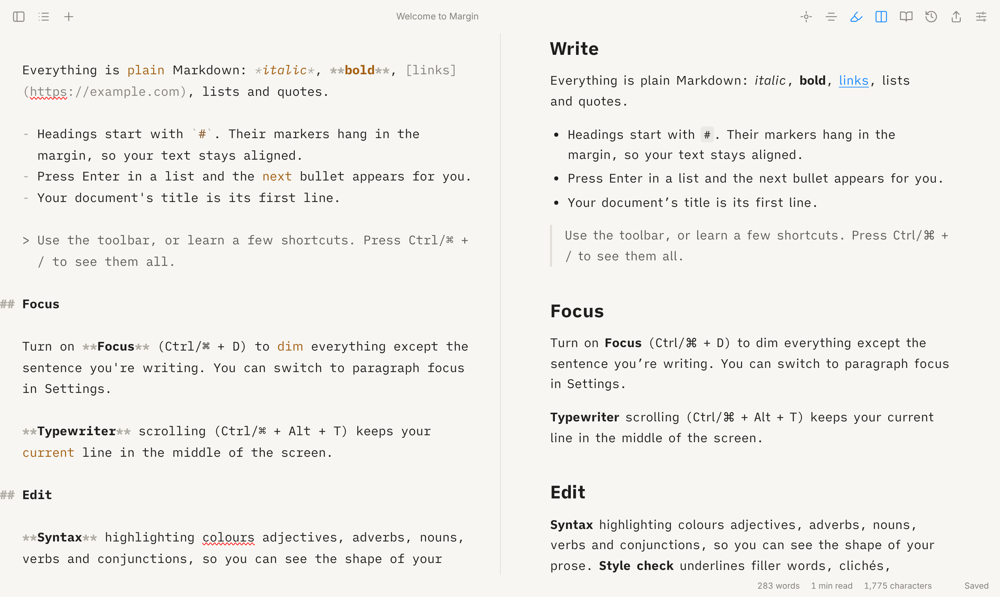

# Margin

A quiet, offline-first place to write, inspired by [iA Writer](https://ia.net/writer). Plain Markdown, beautiful type, and tools that help you write better without getting in the way.



Margin is a Progressive Web App. It runs in any modern browser, installs to your dock or home screen, works with no connection, and keeps every document on your device.

## Features

**Writing**
- Distraction-free Markdown editor set in iA Writer's own typefaces (Mono, Duo, Quattro), with headings that hang in the margin and wrapped list items that line up under their text.
- The interface fades away while you type and comes back when you move the mouse.
- Autosave as you type. Your document's title is its first line.
- Live word count, reading time and character count, plus a word count for the selection.
- Light, dark or system theme, three line widths, adjustable text size, browser spellcheck, and find & replace (Ctrl/⌘ F).

**Focus**
- **Focus mode** dims everything except the sentence (or paragraph) you're writing.
- **Typewriter scrolling** keeps the current line vertically centred.

**Editing**
- **Syntax highlighting** colours nouns, verbs, adjectives, adverbs and conjunctions, each of which you can toggle. (The language model loads only when you turn this on.)
- **Style check** underlines filler words, clichés and redundancies (with a suggested fix), and highlights repeated words. Hover over a flagged phrase to see why. Code, URLs and HTML are never flagged.

**Preview & export**
- A live preview beside the editor that scrolls with it, or a full-width reading view.
- Export to Markdown, a standalone HTML page, or print and save as PDF (typeset in iA Writer Quattro).

**Version history**
- An automatic snapshot every 10 minutes while you write, and when you switch documents. Press Ctrl/⌘ S to save a version yourself.
- Compare any version with your current text in a word-level diff, and restore it. Restoring saves your current text first, and you can undo it.
- Old automatic snapshots are thinned out over time (all from the last day, one per hour for a month, then one per day). Versions you saved yourself are kept.

**Outline**
- A sidebar of your headings. Click one to jump to it; the section you're in is highlighted.

**Your data**
- Documents and history live in your browser's IndexedDB. Nothing is sent anywhere.
- **Export → Back up everything** downloads a `.zip` containing every document as a `.md` file, plus a full backup with version history.
- **Import** accepts `.md`, `.txt`, Margin backups, or a `.zip` of either. Importing a backup never overwrites a newer copy of a document.
- Open in two tabs and edits sync between them.

## Keyboard shortcuts

On macOS, Ctrl is ⌘ and Alt is ⌥. Press Ctrl/⌘ / in the app to see them all.

| Action | Shortcut |
| --- | --- |
| Focus mode | Ctrl D |
| Typewriter scrolling | Ctrl Alt T |
| Syntax highlighting | Ctrl Alt Y |
| Style check | Ctrl Alt C |
| Preview beside editor | Ctrl Alt P |
| Reading view | Ctrl Alt R |
| Library / Outline | Ctrl Alt L / Ctrl Alt O |
| Version history | Ctrl Alt H |
| Save a version | Ctrl S |
| New document | Ctrl Alt N |
| Bold / Italic / Link | Ctrl B / Ctrl I / Ctrl K |
| Settings | Ctrl , |

## Getting started

Requires Node 20 or newer.

```sh
npm install
npm run dev        # http://localhost:5173
```

| Command | What it does |
| --- | --- |
| `npm run dev` | Start the dev server with hot reload |
| `npm run build` | Typecheck and build to `dist/` |
| `npm run preview` | Serve the production build |
| `npm test` | Unit tests (Vitest) |
| `npm run test:e2e` | End-to-end tests in Chromium (Playwright). Run `npx playwright install chromium` once first |
| `npm run typecheck` | TypeScript only |

## Installing it as an app

Margin is a static site, so it can be hosted anywhere (GitHub Pages, Netlify, Cloudflare Pages, or any web server) and then installed:

- **Chrome / Edge:** click the install icon in the address bar.
- **Safari (macOS):** File → Add to Dock.
- **iPhone / iPad:** Share → Add to Home Screen.

### GitHub Pages

`.github/workflows/deploy.yml` builds and publishes the app on every push to `main` once you switch it on:

1. Settings → Pages → Source: **GitHub Actions**. (GitHub Pages needs a public repository, or a paid plan for private ones.)
2. Settings → Secrets and variables → Actions → Variables: add `PAGES_ENABLED` = `true`.

The build uses relative paths, so it works from any sub-path.

## How it's built

[Vite](https://vite.dev) + TypeScript + React, with [CodeMirror 6](https://codemirror.net) as the editor.

```
src/
  actions.ts         App behaviour: opening, saving, versions, settings, cross-tab sync
  store.ts           App state (zustand)
  editor/            CodeMirror setup and extensions
    bridge.ts          The one EditorView, and how React talks to it
    focus.ts           Focus mode
    typewriter.ts      Typewriter scrolling
    partsOfSpeech.ts   Syntax highlighting (lazy-loads tagger.ts, which uses compromise)
    styleCheck.ts      Style check decorations
    markdownStyle.ts   Markdown styling, hanging headings and list indents
  text/              Pure, unit-tested text logic: sentences, stats, style rules, outline, titles
  history/policy.ts  When to snapshot, and which versions to keep
  storage/           IndexedDB (via idb): documents, versions, backups
  preview/           Markdown rendering (markdown-it + DOMPurify) and its stylesheet
  export/            Markdown/HTML/PDF export, zip backup and import
  ui/                React components
tests/e2e/           Playwright tests that drive the real build
```

Optional pieces (the preview renderer, export, history and the part-of-speech tagger) are split into separate chunks and loaded on first use. Everything is precached by the service worker so it all works offline.

## Roadmap

These are ideas for what's next, roughly in order of value:

- **Library & search:** folders or tags, full-text search, and quick-open (Ctrl/⌘ K).
- **Files on disk:** open a folder of `.md` files directly with the File System Access API (Chrome/Edge), or wrap Margin in [Tauri](https://tauri.app) for a native desktop app.
- **Goals & stats:** daily word targets, streaks, per-session stats.
- **Images:** paste or drop images into a document.
- **Code blocks:** syntax highlighting in fenced code.
- **Sync:** optional sync between devices.
- **AI assist with authorship:** prompts and rewrites, with AI-written text shown in a different colour (as iA Writer does).

## Credits

iA Writer Mono, Duo and Quattro are by [iA](https://github.com/iaolo/iA-Fonts), licensed under the SIL Open Font License and bundled via [Fontsource](https://fontsource.org). Margin is an independent project and isn't affiliated with iA.
